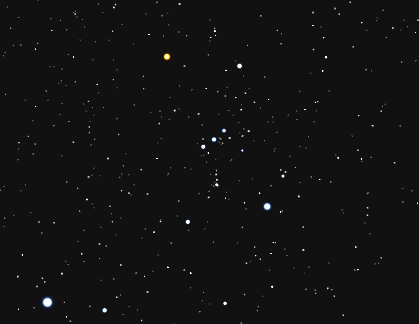

# BSC5P-JSON-XYZ

A compact star catalog derived from BSC5P and related source data, prepared for rendering, visualization, and simulation workflows.

This catalog provides stellar positions in two coordinate representations:

- Cartesian coordinates (`x`, `y`, `z`) for 3D rendering and simulation workflows
- Celestial coordinates (`r`, `d`) for sky-map, astronomy, and projection-based workflows

Distances are expressed in parsecs where available.

## Intended use

This project is designed primarily for graphics, visualization, and interactive software that needs a compact stellar dataset with practical runtime-friendly fields.

## Data provenance and caveats

This project augments the original BSC5P catalog with additional fields computed, estimated, or inferred from available source data. Not all added values are direct measurements, and downstream users should treat derived fields accordingly.

Unless otherwise noted, `x`, `y`, and `z` represent a Cartesian export used by this project. Consumers should not assume direct interoperability with other astronomy datasets unless the coordinate frame, axis orientation, and origin are explicitly matched.

Rendering-oriented fields such as color and brightness are useful in visualization pipelines, but they should not be treated as precision astrophysical observables without independent validation.

## Example use

The catalog has been used successfully in real-time visualization workflows. The example below shows its use in the Cosmosis project as a practical rendering reference rather than a scientific validation benchmark.

## Schema design

This catalog is optimized for compact distribution and runtime loading, especially in graphics and game-oriented applications. Short JSON keys reduce transfer size and parsing overhead, but they also make the raw files less self-describing. The schema reference below should therefore be treated as normative documentation.

In practice, shortened keys can materially reduce file size compared with a fully verbose JSON schema, especially across large catalogs.

## Core catalog schema

| Key | Type | Units / Format | Description | Present in |
|-----|------|----------------|-------------|------------|
| `i` | `number \| string` | — | Stable star identifier. Usually the original BSC5P line ID; custom entries may use a string identifier such as `Custom [n]`. This field is also used to link related records across files. | all core files |
| `n` | `string` | UTF-8 text | Preferred display name for the star, where available. | named catalogs |
| `p` | `number` | parsecs | Distance from observer/reference origin. | positional catalogs |
| `r` | `number` | radians | Right ascension. | celestial-coordinate catalogs |
| `d` | `number` | radians | Declination. | celestial-coordinate catalogs |
| `x` | `number` | parsecs | Cartesian X coordinate used by this project's export pipeline. | 3D-coordinate catalogs |
| `y` | `number` | parsecs | Cartesian Y coordinate used by this project's export pipeline. | 3D-coordinate catalogs |
| `z` | `number` | parsecs | Cartesian Z coordinate used by this project's export pipeline. | 3D-coordinate catalogs |
| `N` | `number` | project-defined scalar | Approximate brightness/luminosity-style value intended primarily for rendering and scaling workflows. Not a rigorously validated astrophysical luminosity field. | visualization-oriented catalogs |
| `K` | `number[3]` | RGB array, 0–255 | Approximate display color derived from stellar temperature or related source data. Intended for rendering, not photometric ground truth. | visualization-oriented catalogs |

## Spectral extension schema (`bsc5p_spectral_extra`)

The fields below belong to the spectral extension object or file and are scoped separately from the core catalog keys above. Identical key letters in this section do not imply the same meaning as keys in the core catalog.

| Key | Type | Units / Format | Description |
|-----|------|----------------|-------------|
| `i` | `number \| string` | — | Foreign key linking the spectral record to the corresponding core catalog star record. |
| `s` | `string` | spectral notation | Spectral type string as preserved or normalized from source data. |
| `t` | `number` | kelvin | Estimated effective surface temperature. |
| `m` | `number` | solar masses | Estimated stellar mass. |
| `R` | `number` | solar radii | Estimated stellar radius. |
| `L` | `number` | solar luminosities (`L☉`) | Estimated physical luminosity within the spectral-extension record. |
| `lc` | `string` | MK luminosity class | Luminosity class classification such as `V`, `III`, or `Ia`. |

## Known limitations

- Some fields are estimated or inferred rather than directly measured.
- Cartesian coordinates are project-export coordinates and should not be assumed to match every external astronomy tool without frame verification.
- Rendering-oriented fields such as color and brightness are useful for visualization but should not be treated as precision astrophysical observables without independent validation.

## Future extensions

Additional classification flags may be added in future versions, including support for carbon stars, S-type stars, T-type objects, T Tauri stars, and Wolf-Rayet stars where source quality permits.